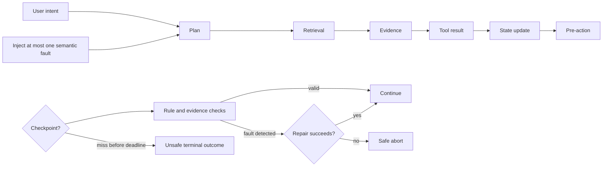

# Frozen experiment blueprint (Prompt 07)

The machine-readable protocol is `configs/frozen_protocol.json`. This file was written before test execution. Primary endpoint: all-case unsafe outcome rate. Test results are not used to change checkpoint locations.

**Seven stages:** 0 intent, 1 plan, 2 retrieval, 3 evidence, 4 tool result, 5 state update, 6 pre-action. Every case begins valid. A syntactically well-formed mutation can change price, quantity, destination, permission, SKU, provenance token or stock. Fault location probabilities are profile-specific and fixed in the config. A fault remains latent until caught or its deadline (fault stage plus 0/1/2 stage intervals) passes. The selected checkpoint runs before the deadline comparison in each stage. A caught fault is either repaired (90%, predetermined per-case random uniform) or safely aborted; otherwise the episode enters an **abstract** unsafe terminal state. There is no actual payment or external API operation.

**Verifiers:** `rule` checks task constraints; `evidence` checks synthetic trusted catalog and provenance; heterogeneous conjunction checks both. Each verifier is deterministic, fault-specific and infallible given the deliberately simplified trusted data. Check cost is 1.0 or 1.5 abstract units per invocation; heterogeneous 2.5. These are not elapsed time or API prices.

**Methods:** none `()`, final `(6,)`, periodic `(1,3,5)`, global 3-of-7 dev optimization, context-specific 3-of-7 dev optimization, plus rule-only and evidence-only ablations on context-specific positions. Optimization uses exhaustive enumeration of 35 combinations, minimizing (unsafe count, safe-abort count, verification cost, then stage tuple). Because only development cases determine placement, no test-label leakage occurs. Policies are evaluated on identical test cases with identical predetermined repair outcomes.

**Split:** development seed 99173, count 5,000; held-out test seeds 101,202,303,404,505 with 3,000 each. Fixed 60% probability of injection and 90% successful repair probability. User-facing profile is available to the adaptive policy; true latent faults are not. The sensitivity analysis artificially flips the policy-routing context at probabilities 0, .25, .5, and 1, leaving true faults unchanged.

**Analysis:** `trial_outcomes.csv` includes case IDs, true fault stage, detection location and final outcome. `evaluate.py` checks method coverage, exactly one outcome per case, no duplicates, disjoint dev/test and legal detection labels; creates aggregate means and paired case-bootstrap differences (1,200 resamples). No claim of statistical inference outside this simulator.

**Pre-experiment checklist:** question and primary metric fixed; seeds and case counts fixed; candidate methods/comparator schedule fixed; dev-only selection fixed; no tuned parameters based on test; success/unsafe/safe-abort categories mutually exclusive; no real LLM claims; cost measured in arbitrary units. **One post-run software correction** is documented in `logs/debugging.md`: CSV blank checkpoint positions were parsed as NaN; only the evaluator's empty-cell handling changed, not the simulation, cases or protocol.
